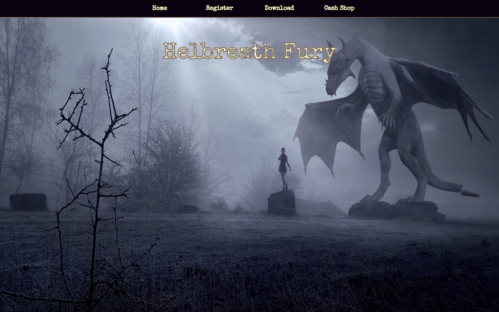

# Helbreath Fury site

The website of **Helbreath Fury**, a Helbreath private server: the news on the home page, kept by the admin from the site itself, a Register page and a Cash Shop page (forms only, not yet wired to a game database). PHP over MySQL, 2023. Live at **[kazin.dev/hbsite](https://kazin.dev/hbsite/)**.

**Made without AI** until the first Claude commit (aa92622, 2026-10-18); AI was used after that for the updated deployment and this README.

[](https://kazin.dev/hbsite/)

## What a visitor meets

- **Home**: the server's banner over the news, newest first.
- **Register**: the account form (name, password, email).
- **Download** and **Cash Shop**: the client download and the shop's form.
- **Admin** (`admin.php`): a password login; then Home shows Add / Modify / Delete on each news item.

## What runs behind it

- **PHP** pages with the shared helpers in `functions.php` (database, session, the news queries); the admin password is kept as a `password_hash` in the settings.
- **MySQL** database `hbsite` (`schema.sql`, safe to run again).
- `config.php` (git-ignored; copy `config.sample.php`): the database login and the admin password's hash (`php -r "echo password_hash('<password>', PASSWORD_DEFAULT);"`). The server keeps its own.

## Deploying

`powershell -ExecutionPolicy Bypass -File deploy.ps1` uploads the tracked files to the Ubuntu box (ssh alias `kazin-music`), never `config.php`: files in `/var/www/hbsite`, served by Caddy (`/etc/caddy/sites/kazin.dev.d/hbsite.caddy`) through php-fpm.

## Layout

```
index.php                 the home and the news, with the admin's Add / Modify / Delete
register.php, cash_shop.php, admin.php
functions.php             database, session and news helpers
schema.sql                the database
styles/, scripts/, img/   the stylesheet, the scripts, the banner and the icons
config.sample.php         the settings template;  deploy.ps1  the deploy
docs/screenshots/         the screenshot above
```

## History

- **2023-04**: the site: news with its admin, the Register and Cash Shop forms.
- **2026-10**: published on the Ubuntu box at kazin.dev/hbsite with a one-command deploy.
